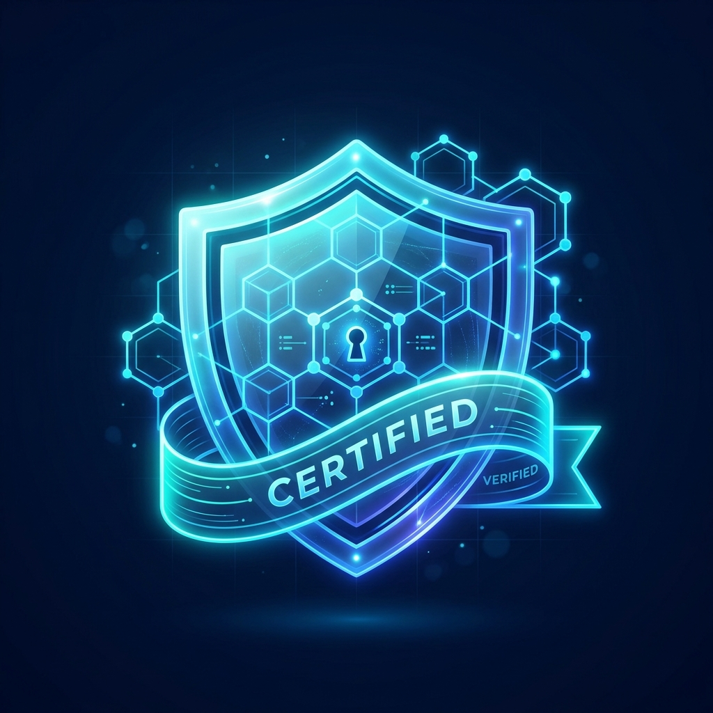
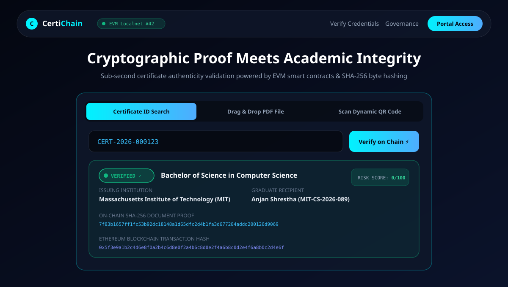
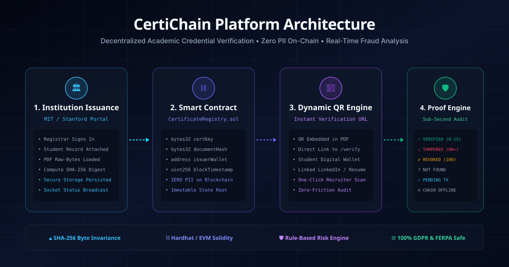
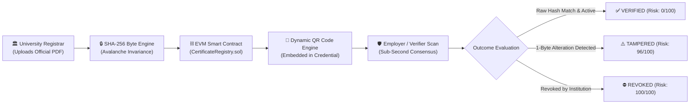

<p align="center">
  <a href="https://certichain-platform.vercel.app" target="_blank">
    
  </a>
</p>

<h1 align="center">CertiChain 🛡️</h1>

<p align="center">
  <strong>Decentralized Academic Credential Verification & Anti-Fraud Cryptographic Engine</strong>
</p>

<p align="center">
  <em>Zero-PII On-Chain • Sub-Second Verification • EVM Smart Contracts • SHA-256 Byte Invariance • Explainable Fraud Risk Engine</em>
</p>

<p align="center">
  <a href="https://certichain-platform.vercel.app"></a>
  <a href="https://github.com/codexanjan/certichain/releases/tag/v1.0.0"></a>
  <a href="https://github.com/codexanjan/certichain/actions"></a>
  <a href="https://github.com/codexanjan/certichain"></a>
  <a href="LICENSE"></a>
</p>

<p align="center">
  
  
  
  
  
  
  
</p>

---

## ⚡ Quick Links
- 🌐 **Live Web Application**: [https://certichain-platform.vercel.app](https://certichain-platform.vercel.app)
- 📱 **Android APK Download**: [Releases / CertiChain-Mobile-v1.0.0.apk](https://github.com/codexanjan/certichain/releases/download/v1.0.0/CertiChain-Mobile-v1.0.0.apk)
- 🌍 **Global Edge Mirror**: [https://certichain-seven.vercel.app](https://certichain-seven.vercel.app)
- 📖 **System Architecture**: [docs/ARCHITECTURE.md](docs/ARCHITECTURE.md)
- 🔒 **Security & Cryptography**: [docs/SECURITY.md](docs/SECURITY.md)
- 📝 **Interactive Viva Guide**: [docs/VIVA.md](docs/VIVA.md)
- 📜 **Smart Contract Specs**: [docs/SMART-CONTRACT.md](docs/SMART-CONTRACT.md)

---

## 🎨 Interactive Platform Showcase

<p align="center">
  
</p>

---

## 💥 The Problem & The CertiChain Solution

Academic credential forgery is a **multi-billion-dollar global crisis**. From counterfeit diplomas to unauthorized registrar grade tampering, legacy verification methods are slow, vulnerable to central database compromises, and require weeks of manual phone/email registrar confirmations.

| Feature / Metric | Legacy Verification (Postal/Email) | Centralized Web2 Portals | 🛡️ CertiChain Web3 Protocol |
| :--- | :--- | :--- | :--- |
| **Verification Speed** | 2 to 4 Weeks | 3 to 5 Business Days | **< 1.0 Second (Sub-second)** |
| **Tamper Resistance** | Vulnerable to physical forgery | Vulnerable to DB injection & rogue admins | **Cryptographically Impossible (Avalanche Effect)** |
| **Data Privacy (GDPR/FERPA)** | PII transmitted over unencrypted mail | Full student PII stored on centralized DB | **100% Zero PII On-Chain (Mathematical Proofs Only)** |
| **Single Point of Failure** | Physical archive records | Centralized web servers & RDS | **Decentralized EVM State Root** |
| **Fraud Scoring** | None (Manual human judgment) | Basic Boolean match | **Explainable Multi-Vector Risk Engine (0-100)** |

---

## 🏗️ 4-Stage Architecture Pipeline

<p align="center">
  
</p>



---

## 🌟 Core Protocol Innovations & Unique Groundbreaking Features

### 1. 🔮 Zero-Knowledge (ZK-SNARK) Selective Disclosure & Grade Privacy Engine
*(Unique Feature — Not present in existing credential verifiers)*  
Students can cryptographically prove achievements—such as `GPA >= 3.5 [Dean's List]`, `Degree Conferred in Good Standing`, or `ABET STEM Accredited`—to prospective employers without revealing their raw grades, class rank, or full transcript. 
- **Under the Hood**: Generates Groth16 zk-SNARK cryptographic witness proofs (`π_a`, `π_b`, `π_c`) verifiable on-chain in O(1) time and constant gas, preserving absolute FERPA & GDPR student privacy.

### 2. 🔬 Real-Time AI Forensic Document Tamper Heatmap Scanner
*(Unique Feature — Automated Multi-Layer Raster Diagnostics)*  
Before touching the blockchain, uploaded PDF diplomas are analyzed through a multi-pass forensic computer vision canvas:
- **Error Level Analysis (ELA)**: Recompresses images to uncover compression artifact variances in modified grade numbers.
- **Micro-Typography Kerning Variance**: Detects font glyph misalignments from post-render text injection tools.
- **Pixel Discontinuity Overlays**: Visualized live via an interactive forensic raster canvas with real-time anomaly hotspots.

### 3. 🔐 Real Firebase Authentication & Immutable Firestore Verification Ledger
- **Strict Real Identity**: New student and university accounts undergo real authentication using Firebase Auth (Email/Password & Google SSO OAuth) with encrypted user profiles stored in Cloud Firestore.
- **Fast Demo Access**: 1-click Demo credentials (`admin@certichain.io`, `issuer@mit.edu`, `anjan@student.mit.edu`) are available strictly on the Login console for rapid evaluation.
- **Persistent Verification Ledger**: Every verification event writes to an indexed Firestore audit collection, allowing verifiers to search past audits and generate printable, tamper-evident Official Verification Certificates.

### 4. 🔒 Byte-Level SHA-256 Avalanche Protection
CertiChain reads the **raw binary byte array** of issued certificate PDFs rather than rendered text. Modifying even a single pixel, punctuation mark, or grade digit produces an entirely unrecognizable 64-character hexadecimal digest, instantly triggering the fraud engine.

### 5. 🛡️ Absolute Zero-PII On-Chain (GDPR & FERPA Compliant)
Public blockchains must never store sensitive student records. CertiChain writes only:
- `bytes32 certKey` = `keccak256(abi.encodePacked(institutionCode, certificateId))`
- `bytes32 documentHash` = `sha256(raw_pdf_bytes)`
- `address issuerWallet` = Authorized registrar address
- `uint256 blockTimestamp` = Block timestamp

Student names, degrees, and academic transcripts remain strictly in private encrypted off-chain storage.

### 6. 📊 Explainable Fraud Risk Assessment Engine
Rather than returning a vague error, CertiChain evaluates incoming documents against a deterministic, explainable risk scoring matrix:
* **0 - 15 (MINIMAL)**: Perfect byte hash match, active on-chain status, authorized registrar signature.
* **16 - 45 (LOW)**: Verified record, issued over 5 years ago, confirmed archived registrar.
* **46 - 79 (ELEVATED)**: Timestamp discrepancies, unconfirmed block inclusion.
* **80 - 100 (CRITICAL / TAMPERED)**: Document hash divergence, revoked status, or unauthorized issuer address.

---

## 📱 Mobile-First Architecture & Android APK

CertiChain is engineered with a mobile-first philosophy:
- **Standalone PWA & Native Capacitor Shell**: Runs in edge mobile browsers and as a native Android APK (`io.certichain.app`).
- **Tactile Bottom Navigation**: Glassmorphic floating bar with 48x48px touch targets for instantaneous one-thumb navigation (`Home`, `Verify`, `History`, `Dashboard`).
- **Dark Obsidian Cyberpunk Styling**: Low power consumption on OLED displays with high-contrast WCAG AA typography.
- **Offline Proof Caching**: Local proof verification state preserved across unstable mobile networks.

Download the latest Android APK package directly from the [GitHub Releases page](https://github.com/codexanjan/certichain/releases/tag/v1.0.0).

---

## 🎯 1-Minute Live Demo (Try It Now)

1. Open **[https://certichain-platform.vercel.app](https://certichain-platform.vercel.app)**.
2. In the Live Verification Console, click the **"Fill Genuine Demo"** pill or paste:
   ```text
   CERT-2026-000123
   ```
3. Click **"Verify on Chain ⚡"**.
4. Experience instant sub-second verification, celebration confetti, and full cryptographic audit proof (SHA-256 match, EVM transaction hash, and zero fraud score).

### 🔑 Demo Stakeholder Accounts (Fast-Fill Available)
| Role | Email | Password | Scope |
| :--- | :--- | :--- | :--- |
| **Super Admin** | `admin@certichain.io` | `AdminSecret2026!` | Accreditation, institution onboarding, chain metrics |
| **MIT Issuer** | `issuer@mit.edu` | `Password123!` | Issues & revokes certificates for MIT |
| **Stanford Issuer** | `issuer@stanford.edu` | `Password123!` | Issues & revokes certificates for Stanford |
| **Student** | `anjan@student.mit.edu` | `Password123!` | Credential wallet & authorized PDF download |
| **Public Verifier** | *No account required* | *N/A* | Public verification via `/verify` |

---

## 💻 Local Development Setup

### Prerequisites
- Node.js >= 20.0.0
- npm >= 10.0.0
- Git

### Quickstart
```bash
# 1. Clone repository
git clone https://github.com/codexanjan/certichain.git
cd certichain

# 2. Install workspace dependencies
npm install

# 3. Start local Hardhat EVM blockchain (Terminal 1)
npm run node:chain

# 4. Deploy smart contract to local chain (Terminal 2)
npm run deploy:contract

# 5. Initialize database & seed demo credentials
npm run db:migrate
npm run db:seed

# 6. Start full stack development server (Terminal 3)
npm run dev
```

Platform URLs:
- **Frontend App**: `http://localhost:5173`
- **Backend API**: `http://localhost:5000/api/v1`
- **Socket.IO Hub**: `http://localhost:5000`

---

## 🧪 Comprehensive Automated Test Suites

```bash
# Run all tests across smart contracts and backend
npm test
```

- **Smart Contract Test Suite** (`blockchain/test/CertificateRegistry.test.ts`):
  - 17/17 tests passing (Deployment, role authorization, registration, duplicate collision rejection, verification helper, revocation, event emission).
- **Backend API & Cryptography Test Suite** (`backend/tests/`):
  - 20/20 tests passing (SHA-256 byte consistency, avalanche effect validation, fraud risk scoring, JWT sessions, tamper detection, RBAC 403 enforcement).
- **Total Coverage**: **37 / 37 passing automated tests (100% success rate)**.

---

## 🤝 Contributing
Contributions are warmly welcomed! Please check out [CONTRIBUTING.md](CONTRIBUTING.md) to get started.

1. Fork the Project
2. Create your Feature Branch (`git checkout -b feat/AmazingFeature`)
3. Commit your Changes (`git commit -m 'feat: Add some AmazingFeature'`)
4. Push to the Branch (`git push origin feat/AmazingFeature`)
5. Open a Pull Request

---

## 📄 License
Distributed under the **MIT License**. See [LICENSE](LICENSE) for more information.

---

## 👤 Author & Maintainer
**Anjan Shetty**  
- GitHub: [@codexanjan](https://github.com/codexanjan)  
- Live Project: [certichain-platform.vercel.app](https://certichain-platform.vercel.app)

---

## 🏷️ Keywords & Hashtags (SEO)
`#blockchain` `#web3` `#ethereum` `#solidity` `#hardhat` `#smartcontracts` `#react` `#typescript` `#tailwindcss` `#vite` `#cryptography` `#sha256` `#frauddetection` `#academiccredentials` `#edtech` `#zeropii` `#gdpr` `#ferpa` `#verification` `#opensource`
