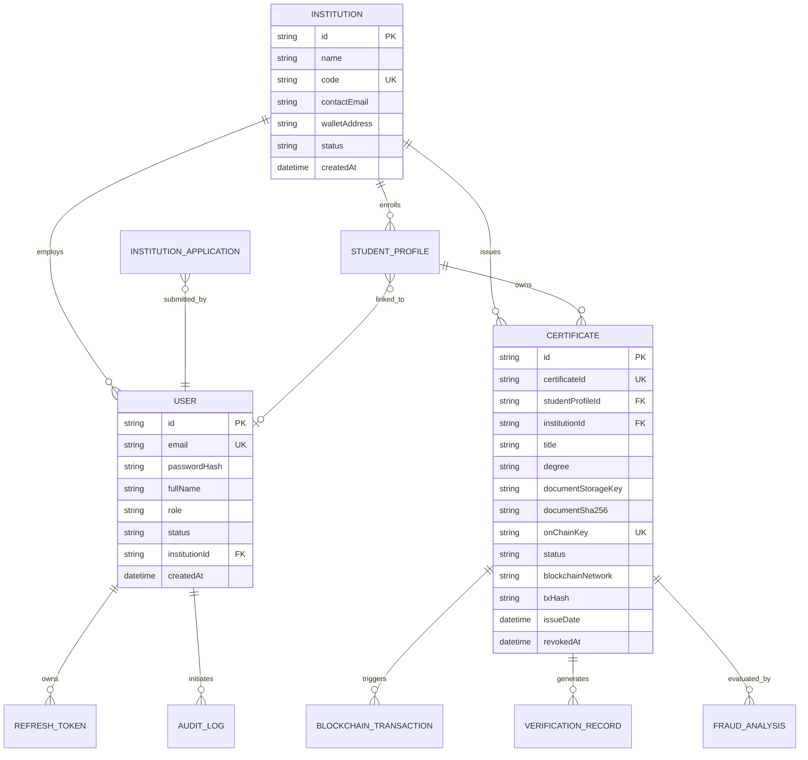

# Database Architecture & Schema Specification — CertiChain

## 1. Database Philosophy
CertiChain uses **PostgreSQL 16** via **Prisma ORM**.
- **Privacy Boundaries**: Sensitive personal documents and student identifiers are held in protected database tables and restricted file storage. Only anonymized cryptographic proofs (SHA-256) and public metadata are exposed via verification APIs.
- **Audit Trails**: Every administrative action, issuance, revocation, and verification attempt is persistently logged.
- **Relational Integrity**: Foreign key constraints with explicit cascade and referential actions.

---

## 2. Entity-Relationship Diagram

---

## 3. Data Dictionary

### 3.1 `User`
- `id`: UUID (Primary Key)
- `email`: VarChar(255), Unique, Indexed
- `passwordHash`: Text (bcrypt hash)
- `fullName`: VarChar(150)
- `role`: Enum (`SUPER_ADMIN`, `INSTITUTION_ISSUER`, `STUDENT`)
- `status`: Enum (`PENDING`, `ACTIVE`, `SUSPENDED`, `REJECTED`)
- `institutionId`: UUID (Nullable, Foreign Key -> Institution.id)
- `createdAt`, `updatedAt`: Timestamps

### 3.2 `Institution`
- `id`: UUID (Primary Key)
- `name`: VarChar(200)
- `code`: VarChar(50), Unique (e.g., `MIT`, `STANFORD`, `IITB`)
- `contactEmail`: VarChar(255)
- `walletAddress`: VarChar(66), Nullable (Issuer's on-chain public address)
- `status`: Enum (`ACTIVE`, `SUSPENDED`)
- `createdAt`, `updatedAt`: Timestamps

### 3.3 `InstitutionApplication`
- `id`: UUID (Primary Key)
- `applicantUserId`: UUID (Foreign Key -> User.id)
- `institutionName`: VarChar(200)
- `institutionCode`: VarChar(50)
- `officialEmail`: VarChar(255)
- `websiteUrl`: VarChar(255)
- `status`: Enum (`PENDING`, `APPROVED`, `REJECTED`)
- `reviewedByUserId`: UUID (Nullable)
- `reviewNotes`: Text (Nullable)
- `createdAt`, `updatedAt`: Timestamps

### 3.4 `StudentProfile`
- `id`: UUID (Primary Key)
- `institutionId`: UUID (Foreign Key -> Institution.id)
- `userId`: UUID (Nullable, linked registered student user)
- `studentIdentifier`: VarChar(100) (University Roll/Registration Number)
- `fullName`: VarChar(150)
- `email`: VarChar(255)
- `createdAt`, `updatedAt`: Timestamps

### 3.5 `Certificate`
- `id`: UUID (Primary Key)
- `certificateId`: VarChar(50), Unique, Indexed (e.g. `CERT-2026-981245`)
- `studentProfileId`: UUID (Foreign Key -> StudentProfile.id)
- `institutionId`: UUID (Foreign Key -> Institution.id)
- `title`: VarChar(255) (e.g. `Bachelor of Science in Computer Science`)
- `degree`: VarChar(150)
- `department`: VarChar(150)
- `cgpaOrGrade`: VarChar(50)
- `issueDate`: DateTime
- `expiryDate`: DateTime (Nullable)
- `documentStorageKey`: VarChar(255) (Local protected path or cloud key)
- `documentSha256`: VarChar(64), Indexed (Raw byte SHA-256 hash)
- `onChainKey`: VarChar(66), Unique (keccak256 hash of certificateId)
- `status`: Enum (`DRAFT`, `PENDING_BLOCKCHAIN`, `ACTIVE`, `REVOKED`)
- `blockchainNetwork`: VarChar(50) (e.g., `hardhat`, `polygon-amoy`)
- `txHash`: VarChar(66), Nullable (Blockchain transaction hash)
- `blockNumber`: Integer (Nullable)
- `revokedAt`: DateTime (Nullable)
- `revocationReason`: Text (Nullable)
- `createdAt`, `updatedAt`: Timestamps

### 3.6 `BlockchainTransaction`
- `id`: UUID (Primary Key)
- `certificateId`: UUID (Foreign Key -> Certificate.id)
- `action`: Enum (`REGISTER`, `REVOKE`)
- `txHash`: VarChar(66), Nullable
- `network`: VarChar(50)
- `status`: Enum (`QUEUED`, `SUBMITTED`, `CONFIRMED`, `FAILED`)
- `blockNumber`: Integer (Nullable)
- `errorMessage`: Text (Nullable)
- `retryCount`: Integer (Default: 0)
- `submittedAt`: DateTime (Nullable)
- `confirmedAt`: DateTime (Nullable)
- `createdAt`, `updatedAt`: Timestamps

### 3.7 `VerificationRecord`
- `id`: UUID (Primary Key)
- `certificateId`: UUID (Nullable, Foreign Key -> Certificate.id)
- `verificationType`: Enum (`QR_SCAN`, `CERTIFICATE_ID`, `DOCUMENT_UPLOAD`)
- `result`: Enum (`VERIFIED`, `TAMPERED`, `REVOKED`, `NOT_FOUND`, `PENDING`, `BLOCKCHAIN_UNAVAILABLE`)
- `submittedHash`: VarChar(64) (Nullable)
- `ipHash`: VarChar(64) (Anonymized hash for telemetry)
- `userAgent`: Text (Nullable)
- `createdAt`: Timestamp

### 3.8 `FraudAnalysis`
- `id`: UUID (Primary Key)
- `certificateId`: UUID (Nullable, Foreign Key -> Certificate.id)
- `riskScore`: Integer (0 to 100)
- `classification`: Enum (`VERY_LOW`, `LOW`, `MEDIUM`, `HIGH`, `CRITICAL`)
- `reasons`: Json (Array of explainable rule triggers)
- `engineVersion`: VarChar(20) (e.g., `v1.0-rules`)
- `createdAt`: Timestamp

### 3.9 `AuditLog`
- `id`: UUID (Primary Key)
- `userId`: UUID (Nullable)
- `action`: VarChar(100) (e.g., `CERTIFICATE_ISSUED`, `CERTIFICATE_REVOKED`)
- `entityType`: VarChar(50) (e.g., `Certificate`, `User`, `Application`)
- `entityId`: VarChar(100)
- `metadata`: Json (Non-sensitive event data)
- `createdAt`: Timestamp

### 3.10 `RefreshToken`
- `id`: UUID (Primary Key)
- `userId`: UUID (Foreign Key -> User.id)
- `tokenHash`: VarChar(255), Unique
- `expiresAt`: DateTime
- `isRevoked`: Boolean (Default: false)
- `createdAt`: Timestamp
