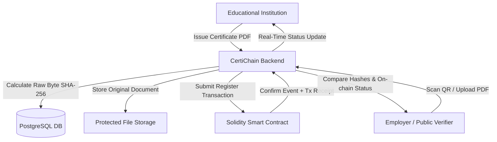

# Software Requirements Specification (SRS) — CertiChain

## 1. Introduction

### 1.1 Purpose
This Software Requirements Specification (SRS) describes the complete functional, non-functional, interface, and security requirements for **CertiChain**, a blockchain-based platform for academic certificate issuance, integrity verification, and fraud detection.

### 1.2 Scope
CertiChain provides:
- Secure role-based management for Super Admins, Educational Institutions, Students, and Public Verifiers.
- Direct PDF upload with raw-byte SHA-256 calculation.
- Smart contract registration on EVM-compatible blockchains.
- Multi-modal verification (QR scanning, Certificate ID, PDF drag-and-drop).
- Real-time event propagation via WebSockets (Socket.IO).
- Explainable rule-based document fraud risk assessment.

### 1.3 Definitions, Acronyms, and Abbreviations
- **EVM**: Ethereum Virtual Machine.
- **SHA-256**: Secure Hash Algorithm 256-bit (FIPS 180-4 standard).
- **PII**: Personally Identifiable Information.
- **RBAC**: Role-Based Access Control.
- **JWT**: JSON Web Token.
- **RPC**: Remote Procedure Call.

---

## 2. Overall Description

### 2.1 Product Perspective
CertiChain serves as a tamper-evident trust middleware connecting educational institutions, graduates, employers, and an EVM blockchain network.

### 2.2 User Characteristics
- **Super Admin**: Highly privileged user managing institutional legitimacy and global audits.
- **Institution Issuer**: Authorized academic staff responsible for credential issuance.
- **Student**: Credential holder claiming and sharing certified accomplishments.
- **Verifier**: Unauthenticated external actor checking authenticity.

---

## 3. Specific Functional Requirements

| Req ID | Category | Description | Acceptance Criteria |
| :--- | :--- | :--- | :--- |
| **REQ-AUTH-01** | Authentication | User registration for students and institution applications. | Reject duplicate emails, validate strong passwords. Institutions require admin approval before issuing. |
| **REQ-AUTH-02** | Authentication | Dual-token authentication with rotation. | 15-minute access token, 7-day secure HTTP-only refresh token. Server-side session invalidation on logout. |
| **REQ-AUTH-03** | Authorization | Server-side role-based access control (RBAC). | Enforce role check on every protected endpoint. Never trust client-supplied claims. |
| **REQ-CERT-01** | Certificate | Unique certificate identification. | Generate non-guessable, structured IDs (e.g. `CERT-2026-XXXXXX`). |
| **REQ-CERT-02** | Certificate | Raw byte SHA-256 hashing. | Compute hash directly from uploaded PDF stream before disk persistence. |
| **REQ-CERT-03** | Certificate | Document storage protection. | Files stored in protected directories; only accessible via authenticated/signed endpoints. |
| **REQ-CHAIN-01** | Blockchain | Smart contract deployment. | Minimal `CertificateRegistry.sol` supporting `registerCertificate`, `revokeCertificate`, `getCertificate`. |
| **REQ-CHAIN-02** | Blockchain | Transaction lifecycle handling. | Track transaction state: `QUEUED`, `SUBMITTED`, `CONFIRMED`, `FAILED`. Recover pending txs on restart. |
| **REQ-CHAIN-03** | Blockchain | Zero PII on-chain. | Only `bytes32` certificate key, `bytes32` SHA-256 hash, issuer address, and timestamps are stored on-chain. |
| **REQ-VERIF-01** | Verification | Public Certificate ID lookup. | Retrieve public metadata and compare live with on-chain status. |
| **REQ-VERIF-02** | Verification | Document file integrity verification. | Re-hash uploaded PDF and compare strictly against on-chain hash. |
| **REQ-VERIF-03** | Verification | Deterministic verification status. | Return exactly one of: `VERIFIED`, `TAMPERED`, `REVOKED`, `NOT FOUND`, `PENDING`, `BLOCKCHAIN UNAVAILABLE`. |
| **REQ-FRAUD-01** | Fraud Engine | Transparent risk evaluation. | Score 0–100 with distinct factor weights. Output clear reasons. Decoupled from blockchain outcome. |
| **REQ-RT-01** | Real-Time | Authenticated WebSocket dispatch. | Scope rooms by user ID and institution ID. Broadcast issuance progress and verification alerts. |

---

## 4. Non-Functional Requirements

### 4.1 Performance Requirements
- **Verification Response Time**: Under 500ms for ID lookup; under 1.2s for file upload hashing and blockchain check.
- **Concurrency**: Support minimum 50 simultaneous verification queries on standard development hardware.

### 4.2 Security Requirements
- **Input Validation**: Strict schema enforcement using Zod on all incoming requests.
- **Upload Hardening**: Maximum 10MB file limit, MIME type validation, magic byte header verification.
- **CORS & Headers**: Strict CORS origin allowlisting and Helmet security headers.
- **Rate Limiting**: Tiered rate limits on public verification and authentication routes.

### 4.3 Reliability & Fault Tolerance
- **Blockchain Degraded Mode**: If RPC fails, return `BLOCKCHAIN VERIFICATION UNAVAILABLE` without crashing or falsely verifying.
- **Database Resilience**: PostgreSQL connection pool handling with automatic reconnects.
